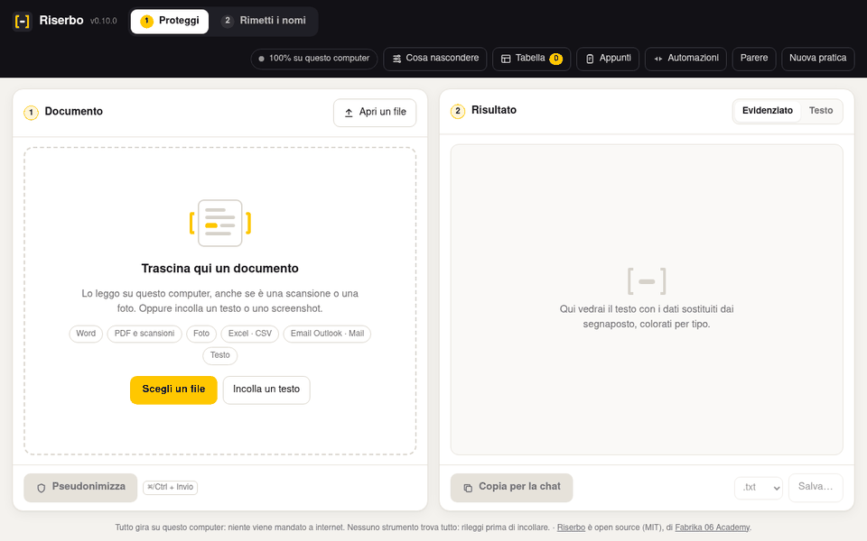
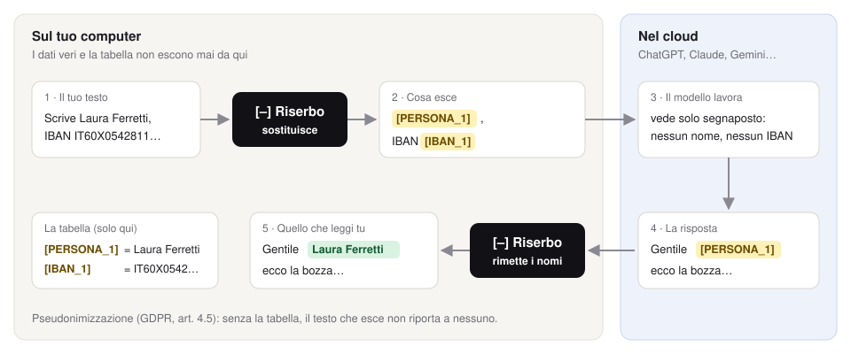
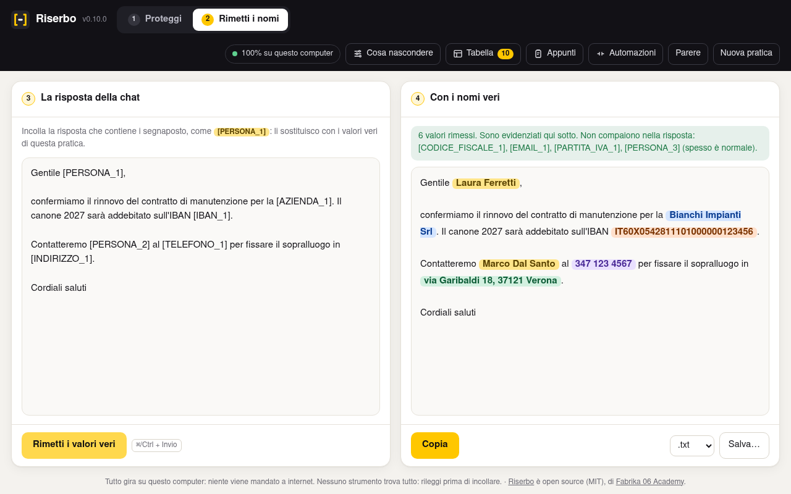

<h1 align="center">Riserbo</h1>

<b>Usa ChatGPT, Claude e Gemini senza consegnargli i dati dei tuoi clienti.</b>

Riserbo sostituisce nomi, codici fiscali, IBAN e indirizzi con segnaposto <i>prima</i> che il testo esca dal tuo computer, 
e nella risposta rimette i valori veri. Gira tutto in locale. Open source, gratuito.

<a href="https://github.com/Fabrika-06-Academy/riserbo/releases/latest/download/riserbo-mac-apple-silicon.dmg"><b>Scarica per Mac</b></a> (Apple Silicon)
&nbsp;·&nbsp;
<a href="https://github.com/Fabrika-06-Academy/riserbo/releases/latest/download/riserbo-windows.zip"><b>Scarica per Windows</b></a>
&nbsp;·&nbsp;
<a href="https://academy.fabrika06.com/riserbo/">Pagina del progetto</a>

## Il problema

Un'email di un cliente, un contratto, un Excel di fornitori: incollarli in ChatGPT è comodo, ma vuol dire mandare a un
fornitore americano nomi, codici fiscali, IBAN e indirizzi di persone che non te l'hanno chiesto. Rinunciare all'AI non è
la risposta. Mandarle solo quello che le serve, sì: per scrivere una risposta a un cliente il modello non ha bisogno di
sapere *come si chiama*.

## Come funziona

1. **Riserbo trova i dati** con un riconoscitore di entità italiano che gira sul tuo computer, più regole che **verificano**
   codici fiscali, partite IVA e IBAN (un numero a caso non viene scambiato per un IBAN).
2. **Li sostituisce con segnaposto** come `[PERSONA_1]` o `[IBAN_1]`. Lo stesso valore riceve sempre lo stesso segnaposto,
   così il modello capisce che si parla della stessa persona.
3. **Il modello lavora** sul testo con i segnaposto: riassume, risponde, traduce, corregge.
4. **Riserbo rimette i valori veri** nella risposta e ti avvisa se il modello ha perso o inventato qualche segnaposto.

La tabella che collega segnaposto e valori resta solo in memoria sul tuo computer e si cancella con «Nuova pratica», dopo
un'ora senza usarla o chiudendo l'app.

| Prima | Cosa esce dal tuo computer |
|---|---|
| le scrivo per conto della dott.ssa **Laura Ferretti** (CF **FRRLRA79D52L781G**), titolare della **Bianchi Impianti Srl**, **via Garibaldi 18, 37121 Verona**. Il canone verrà pagato sull'IBAN **IT60X0542811101000000123456**. | le scrivo per conto della dott.ssa `[PERSONA_1]` (CF `[CODICE_FISCALE_1]`), titolare della `[AZIENDA_1]`, `[INDIRIZZO_1]`. Il canone verrà pagato sull'IBAN `[IBAN_1]`. |

## Dove funziona: dove lavori già

| | Come | Per chi |
|---|---|---|
| **Nel browser** | Estensione per ChatGPT, Claude, Gemini, Copilot, Mistral, Perplexity e DeepSeek. Quando premi Invio i dati diventano segnaposto *nel riquadro*, così vedi cosa parte; nelle risposte leggi i nomi veri. Se la risposta è un testo modificabile (per esempio la bozza di email di ChatGPT), il pulsante **[–] Nomi veri** la mostra con i nomi in un riquadro privato, pronta da copiare. | tutti |
| **Nella finestra di Riserbo** | Trascini un documento: Word, PDF anche scansionati, foto, Excel, CSV, email di Outlook e Mail. Ottieni il testo protetto, lo stesso file nel suo formato o un **PDF oscurato**. | chi lavora sui documenti |
| **Nelle app di AI sul computer** | Le app di ChatGPT, Claude, Copilot e Perplexity: con la **modalità automatica**, quando passi all'app gli appunti diventano la versione protetta (⌘V incolla già i segnaposto) e quando esci tornano i nomi veri. Nessuna scorciatoia da ricordare. | chi usa le app desktop |
| **In qualunque programma** | Copi il testo, premi **⌃⌥P** (Ctrl+Alt+P su Windows) e incolli la versione protetta. Copi la risposta, premi **⌃⌥R** e tornano i nomi veri. | chi lavora in Outlook, nel gestionale, in WhatsApp Web |
| **Nelle automazioni** | n8n, Make, script e programmi che usano le API di OpenAI o Anthropic passano da Riserbo: basta cambiare il «Base URL». Ogni richiesta esce protetta, anche in streaming, con un registro di cosa è uscito. | chi automatizza |
| **In Claude Desktop** | Claude legge i documenti delle cartelle che scegli *attraverso* Riserbo: vede solo segnaposto, anche nei nomi dei file. Quando salva una risposta, i nomi veri li rimette Riserbo sul tuo disco. | chi usa gli agenti |

Riserbo resta acceso nell'icona **[–]** vicino all'orologio e può partire all'accensione. Al primo avvio si apre la
**Guida**, che spiega ogni modo d'uso e mostra quali sono già attivi; si riapre dal pulsante «Guida».

## Anonimizzare o pseudonimizzare?

Sono due cose diverse, e la differenza conta per il GDPR.

- **Anonimizzare** vuol dire rendere i dati irreversibilmente non riconducibili a una persona. Dati davvero anonimi escono
  dal GDPR (considerando 26). Ma non si può tornare indietro: niente nomi veri nella risposta.
- **Pseudonimizzare** vuol dire sostituire i dati in modo che non si possano attribuire a una persona *senza informazioni
  aggiuntive conservate separatamente* (art. 4, punto 5). È quello che fa Riserbo: le informazioni aggiuntive sono la
  tabella, che resta sul tuo computer.

Quindi: il fornitore del modello riceve testo da cui non può risalire alle persone; tu, che hai la tabella, stai ancora
trattando dati personali. Riserbo **riduce il rischio** e applica la minimizzazione (art. 5), ma il contratto con il
fornitore del modello, il registro dei trattamenti e l'informativa restano necessari. Chi parla di «anonimizzazione
reversibile» descrive in realtà una pseudonimizzazione.

## Cosa riconosce

Persone · aziende · clienti e fornitori (anche dall'anagrafica del gestionale) · luoghi · indirizzi · email · telefoni ·
siti web · codici fiscali · partite IVA · IBAN · targhe · date di nascita · età · dati sanitari · documenti d'identità ·
conti e carte · password e PIN · indirizzi IP e codici dei dispositivi · dati catastali · stato civile · professioni.

Ogni categoria si può lasciare in chiaro (per esempio le città, se servono per rispondere), e si può tenere un elenco di nomi
che non vanno mai nascosti: i tuoi prodotti, la tua azienda. In Excel e CSV le colonne intitolate «Nome», «Ragione sociale»,
«Codice fiscale» vengono nascoste per intero.

## Quanto ci si può fidare

Nessuno strumento trova tutto, e Riserbo non fa eccezione.

- I dati a forma fissa (codice fiscale, partita IVA, IBAN, email, telefoni) vengono trovati da regole con il controllo
  delle cifre: qui le fughe sono rarissime.
- Nomi, aziende e luoghi dipendono dal riconoscitore di entità ([DeepMount00/Italian_NER_XXL_v2](https://huggingface.co/DeepMount00/Italian_NER_XXL_v2),
  un BERT italiano con licenza Apache 2.0). Sul nostro set di prova di testi di PMI (88 entità) ne lascia scoperte 1 o 2,
  senza falsi allarmi. È un set piccolo: un banco di prova più ampio è nei prossimi passi.
- Per questo **si rilegge sempre** prima di inviare: nell'app un clic su un segnaposto lo rimette in chiaro, una selezione
  nasconde una parola ovunque. L'estensione ti mostra il testo protetto nel riquadro prima che parta.

## Cosa esce dal tuo computer

I testi e i documenti: **mai**. Il riconoscitore e l'OCR sono dentro l'app, non c'è nessun account e nessuna telemetria.
All'avvio l'app chiede a GitHub il numero dell'ultima versione, per proporti l'aggiornamento (si può spegnere). Il pannello
**Parere** manda all'Academy solo quello che scrivi lì, quando premi «Invia».

## Installare

**Mac** (Apple Silicon): scarica il [.dmg](https://github.com/Fabrika-06-Academy/riserbo/releases/latest/download/riserbo-mac-apple-silicon.dmg)
e trascina Riserbo in Applicazioni. L'app non è ancora firmata da Apple: la prima volta apri *Impostazioni di Sistema →
Privacy e sicurezza* e premi **Apri comunque**.

**Windows**: scarica lo [zip](https://github.com/Fabrika-06-Academy/riserbo/releases/latest/download/riserbo-windows.zip),
decomprimilo e apri `riserbo.exe`. Se compare «Windows ha protetto il PC»: *Ulteriori informazioni → Esegui comunque*.

**Estensione del browser** (Chrome, Edge, Brave), finché non è sul Chrome Web Store: nell'app apri *Automazioni →
Estensione del browser*, attiva il collegamento e segui le istruzioni (servono due minuti).

**Con Python**, per server e automazioni: vedi [docs/sviluppatori.md](docs/sviluppatori.md).

## Per sviluppatori

Come è fatto (tre strati: regole con verifica delle cifre, riconoscitore di entità, controllo finale facoltativo), uso da
terminale e da Python, il proxy compatibile con OpenAI e Anthropic, il server MCP, il servizio locale e come misurare le
fughe sui tuoi testi: [docs/sviluppatori.md](docs/sviluppatori.md). La direzione del progetto è in [ROADMAP.md](ROADMAP.md).

## Chi lo fa

Riserbo è uno strumento della [Fabrika 06 Academy](https://academy.fabrika06.com), i corsi gratuiti sull'intelligenza
artificiale per le aziende. Il metodo è spiegato nel corso
[Dati protetti e dati dal web](https://academy.fabrika06.com/corso/dati-protetti-dati-dal-web/).
Fino alla versione 0.10 si chiamava *segnaposto*.

Licenza MIT, anche per le app scaricabili. © 2026 Andrea Prando, [Fabrika 06](https://fabrika06.com).
Pareri e segnalazioni: il pannello **Parere** dell'app, oppure le [issue](https://github.com/Fabrika-06-Academy/riserbo/issues).

---

### In English

**Riserbo** ("discretion") lets you use ChatGPT, Claude and Gemini without handing over your clients' data. Before any
text leaves your computer it replaces names, Italian tax codes, VAT numbers, IBANs and addresses with placeholders like
`[PERSONA_1]`, and it puts the real values back into the answer. It runs locally (Italian BERT NER plus checksum-validated
rules), as a desktop app for Mac and Windows, a browser extension for the major chatbots, global hotkeys for any program,
an OpenAI/Anthropic-compatible local proxy for automations, and an MCP server for Claude Desktop. This is
pseudonymisation under GDPR art. 4(5), not anonymisation: it lowers the risk, it does not remove your obligations. MIT licence.
